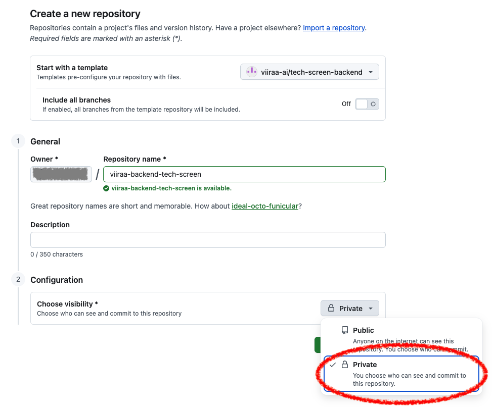

# ViiRaa Backend Take-Home

A small Express + Postgres chat service. It works, but the `GET /conversations/:id/messages` endpoint has gaps. **Your task is to bring it to a quality bar we'd be comfortable shipping.**

Budget **~4 hours**. If you hit the limit, stop and write what you'd do next in `NOTES.md` — that's part of the signal.

We care about clear judgment and clean execution, not completing every optional item.

---

## Getting the code

**Use GitHub's "Use this template" → "Create a new repository"** to make your own copy. **Do not fork or clone-and-push** — forks of a public repo can't be made private, and we need submissions kept confidential.

When creating the repo:

- **Owner**: your personal GitHub account
- **Visibility**: **Private** (required)



---

## Setup

You'll need Docker and Node 20+.

```bash
cp .env.example .env
docker compose up -d           # Postgres on :5432
npm install
npm run db:migrate             # schema in viiraa_chat
npm run db:seed                # ~3 users, 2 conversations, ~220 messages
npm run dev                    # server on :3000
npm test                       # uses sibling DB viiraa_chat_test, auto-reset each run
```

Smoke test:

```bash
curl http://localhost:3000/health
curl 'http://localhost:3000/conversations/aaaaaaaa-aaaa-aaaa-aaaa-aaaaaaaaaaaa/messages?page=1&limit=20'
```

---

## What's here

```
src/
  app.ts              Express app (no listen)
  index.ts            app.listen entry
  db.ts               pg Pool
  routes/
    health.ts
    messages.ts       GET /conversations/:id/messages
  tests/
    messages.test.ts  one happy-path test
db/
  migrations/001_initial_schema.sql
  seed.sql
  migrate.ts          home-grown runner — add new migrations as 002_*.sql, etc.
```

Schema: `users`, `conversations`, `conversation_participants`, `messages` — see [db/migrations/001_initial_schema.sql](db/migrations/001_initial_schema.sql).

Seed IDs:

| Resource | ID |
| --- | --- |
| User Alice  | `11111111-1111-1111-1111-111111111111` |
| User Bob    | `22222222-2222-2222-2222-222222222222` |
| User Carol  | `33333333-3333-3333-3333-333333333333` |
| Conversation A (200 messages) | `aaaaaaaa-aaaa-aaaa-aaaa-aaaaaaaaaaaa` |
| Conversation B (20 messages)  | `bbbbbbbb-bbbb-bbbb-bbbb-bbbbbbbbbbbb` |

---

## What we'd like you to do

### Required

1. **[CHAT-218] Messages sometimes duplicate or skip when scrolling back in long conversations.**

   _Reported by 3 beta users this week and reproduced by QA on the "Metabolic check-in" thread._ When you scroll back through an active conversation to load older messages, occasionally:
   - the same message appears twice in a row, or
   - a message you remember seeing gets skipped on a refresh.

   It seems worse on busier threads, and a couple of users hit it on first load while someone else was sending into the same conversation.

   Mobile thinks the `/conversations/:id/messages` API is returning inconsistent batches between calls. Please make pagination behave consistently across page loads — pick whatever approach you think is right long-term; we'll be opening chat to more users soon, so it should hold up at scale.

   _(Mobile also flagged that the endpoint returns a generic "something went wrong" for anything unusual — bad conversation IDs, missing conversations, negative page numbers. They'd like proper status codes they can branch on. That's covered by item 2 below.)_
2. **Validation and error semantics** — distinguish 400 / 404 / 500 cleanly. Cap page size sensibly.
3. **Structured logging** with request IDs (e.g., pino + a request-id middleware). Replace the `console.log` sprinkle.
4. **Integration tests** covering at minimum: first/middle/last page, empty conversation, malformed pagination input, malformed conversation ID (400), non-existent conversation ID (404).
5. **Schema review** — add the index(es) the query needs.
6. **`NOTES.md`** — design reasoning that doesn't fit in the PR description (see Submission below). What you considered and rejected, what you'd do with more time, anything weird you spotted.

### Optional — pick what's interesting to you

- Backward / bidirectional pagination
- Rate limiting on the endpoint
- Prometheus metrics or OpenTelemetry tracing on DB calls
- Load test script (`autocannon` / `k6`) showing latency before/after the index
- Soft-delete handling for messages
- Anything else you'd want to do if this were yours to own

---

## Ground rules

- AI tools (Copilot, Claude, Cursor, etc.) are encouraged — same as on the job. We care about the result and your judgment.
- Commit as you go. We'll read your git history.
- If something is ambiguous, make a call and note it in `NOTES.md`. Don't block on us.
- If you hit a setup issue you can't get past in ~30 minutes, email us.

---

## Submission

1. Confirm your repo is **private** and created from the template (not a fork).
2. Do your work on a branch and open a **pull request against `main`** in your own repo. We read the PR as part of the eval — commit history, PR description, and diff.
3. PR description should include: **Summary** (what changes), **Why** (what problem this solves), and **Test plan** (concrete checks a reviewer can run). Keep it high-level — the diff shows _what_; the description's job is _why_ and _how to verify_.
4. Make sure `NOTES.md` is on the branch and pushed.
5. Grant **read access** to:
   - `yun.wu@viiraa.com`
   - `aiden.fang@viiraa.com`
   - `lei.zhao@viiraa.com`
6. Reply to our email with the repo URL.

(We'll see your PR once you've granted access — no need to share the PR link separately.)

Please keep the repo private and don't share it elsewhere — it keeps the exercise fair for future candidates.
